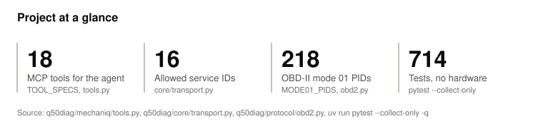
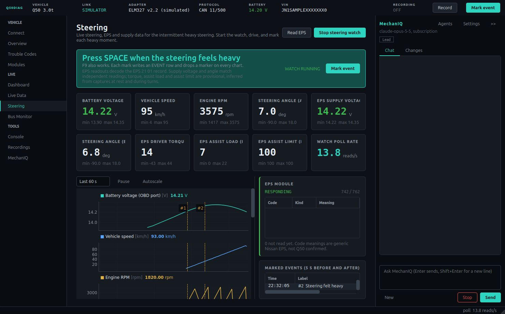
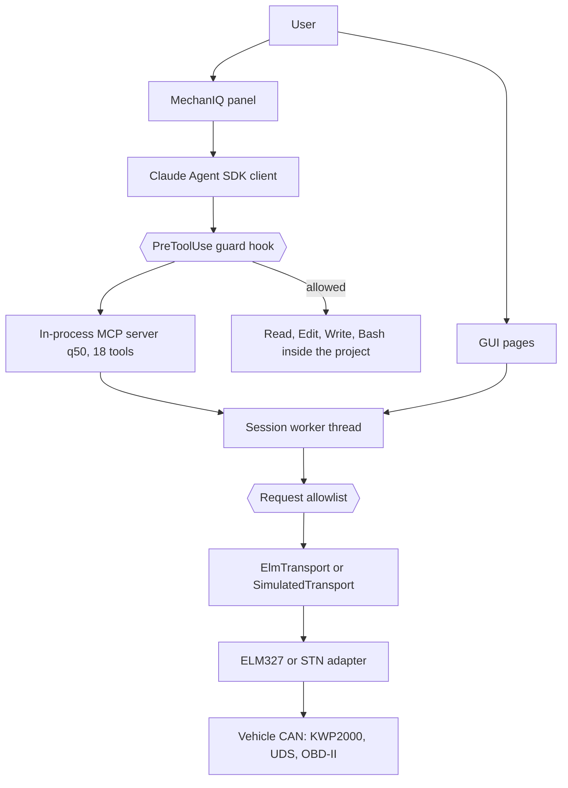
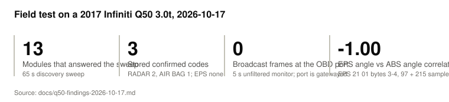
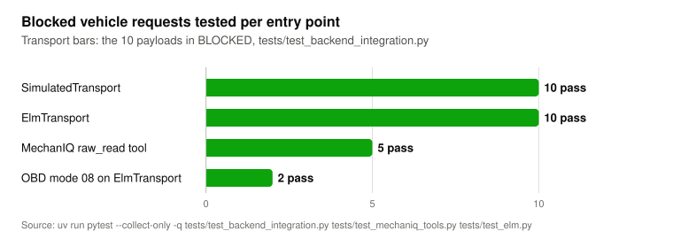

# obd-scanner

A desktop diagnostic app (package `q50diag`) that reads a car over KWP2000, UDS and OBD-II through an ELM327 or STN USB adapter, with an embedded Claude agent, MechanIQ, that reaches the car only through an in-process MCP server and a read-only request gate.

<picture>
  <source media="(prefers-color-scheme: dark)" srcset="docs/figures/overview-dark.svg">
  
</picture>

<details><summary>Data table</summary>

| Measure | Value | Source |
|---|---|---|
| MCP tools exposed to the agent | 18 | `TOOL_SPECS` in q50diag/mechaniq/tools.py |
| Service IDs on the request allowlist | 16 | q50diag/core/transport.py |
| OBD-II mode 01 definitions | 218 | `MODE01_PIDS` in q50diag/protocol/obd2.py |
| Tests, no adapter or API key | 786 | `uv run pytest --collect-only -q` |

</details>

## What it does

- Reads every module that answers on the bus, including chassis and body modules: Nissan KWP2000 local identifiers (`21 xx`, `1A xx`), UDS data identifiers (`22 xxxx`), KWP and UDS trouble codes (`18`, `19 02`), OBD-II modes 01 to 0A.
- Profiles for a 2017 Infiniti Q50 3.0t (15 module addresses) and two Ford Mustang S550 builds (9 UDS modules each), selected with `--vehicle`.
- Pages for overview, trouble codes, per-module identification and identifier explorer, live data and gauges, a steering (EPS) watch with event marks, passive bus monitor, raw console and CSV recordings.
- MechanIQ, a Claude Agent SDK agent in a side panel, reads live values, scans codes, marks events and analyses recordings through 18 MCP tools. It can also edit the app's own source: `apply_change` runs the related tests, hot reloads the changed modules and commits locally, or rejects the change.
- A PreToolUse guard hook blocks the agent's writes outside the project, serial port access, `.env` and settings file access, printing the Anthropic credentials from the environment, `git push` and destructive git commands.
- A simulator transport replays a 90 s drive cycle for each vehicle profile, so the GUI, the agent tools and all 786 tests run without an adapter.

<p align="center"></p>

The screenshot is from `--sim --smoke-seconds 30` with the offscreen Qt platform. All values are simulated; the VIN is synthetic.

## How it works



**Protocol layer.** `q50diag/transport/elm.py` drives the adapter with AT and STN commands: `ATE0 ATL0 ATS1 ATH1 ATAT1`, then the bus (`STP33` or `ATSP6` for HS-CAN 500 kbps, `STP53` for Ford MS-CAN on pins 3/11), then `ATCAF1 ATCFC1 ATD0 ATAL ATFCSM0`. Requests are addressed with `ATSH` and filtered with `ATCRA`. `elm_parse.py` reassembles ISO 15765-2 single, first and consecutive frames per CAN ID, so interleaved replies from two ECUs stay separate. For request and response pairs other than 7E0 to 7E7 with response ID plus 8, the driver sets its own flow control header (`ATFCSH`). A `7F xx 78` (response pending) reply is retried once with `ATAT0 ATSTFF`, the longest ELM timeout. Nissan modules get `10 C0` (CONSULT session), falling back to `10 03`, before `21 xx` and `22 xxxx` reads (`q50diag/protocol/nissan.py`). Ford modules use UDS `22 F190`, `F188`, `F113` and `19 02 FF`, retrying in the extended session on NRC 7E or 7F (`q50diag/protocol/ford.py`).

**Request gate.** Every request from the GUI, the console, discovery and the agent passes `check_request_allowed` in `q50diag/core/transport.py`. It is an allowlist: OBD modes 01, 02, 03, 05, 06, 07, 09, 0A; services 17, 18, 19, 1A, 21, 22; tester present 3E; and session control 10 only with sub-functions 01, 03, 81, 89 or C0. Clear codes (04, 14) pass only with `allow_clear=True`, which the Trouble Codes page sets after a confirmation dialog. Everything else, including ECU reset 11, security access 27, write 2E, I/O control 2F, routine 31, download 34, OBD mode 08 and the programming session 10 02, raises `RequestBlocked`. Module discovery sweeps 0x700 to 0x7FF with tester present (`3E 00`) only and never transmits on an ID that a known ECU or OBD-II uses for responses (`q50diag/protocol/discovery.py`).

**Tool boundary.** The agent gets no serial port. `create_sdk_mcp_server` in `q50diag/mechaniq/tools.py` exposes 18 tools that call into the running app on the Qt main thread: `get_status`, `list_parameters`, `get_readings`, `get_dtcs`, `scan_dtcs`, `read_module`, `start_polling`, `stop_polling`, `start_steering_watch`, `stop_steering_watch`, `mark_event`, `list_recordings`, `read_recording`, `raw_read`, `read_app_log`, `navigate`, `apply_change`, `undo_change`. `raw_read` sends one hex request through the same allowlist and without `allow_clear`, so the agent cannot clear codes. Three subagents are defined in `q50diag/mechaniq/prompt.py`: `code-fixer`, and `data-analyst` and `test-coach`, which have the edit tools and `apply_change` disallowed. `test-coach` also has Bash disallowed; `data-analyst` keeps Bash to compute statistics with Python in a source checkout.

**Guard hook.** The agent runs with `permission_mode="bypassPermissions"` (`q50diag/mechaniq/runner.py`), so one PreToolUse hook (`q50diag/mechaniq/guard.py`) is the boundary. It inspects Write, Edit, MultiEdit, NotebookEdit, Read, Grep, Glob and Bash, and denies PowerShell outright. Bash commands are split into shell segments with `shlex`, so a commit message that mentions `/dev/ttyUSB0` is not treated as a command; leading `VAR=value` assignments and wrappers such as `env`, `nohup` and `timeout` are skipped to find the command; redirect and `tee` targets, the file operands of `cp`, `mv`, `rsync`, `rm`, `touch`, `mkdir` and similar commands, and `dd of=` are checked as file writes, relative to the directory that earlier `cd` segments select. `printenv`, a bare `env`, `set`, `export -p` and any mention of `ANTHROPIC_API_KEY`, `ANTHROPIC_AUTH_TOKEN` or `/proc/*/environ` are denied. Serial access is matched as `/dev/tty`, `/dev/cu.`, `/dev/serial`, `COMn`, `serial.Serial(`, `serial_for_url` and `miniterm`. Windows backslash paths are normalized before the `.env` check. Each denial returns `permissionDecision: "deny"` with a reason that tells the agent what to do instead.

**Change gate.** `apply_change` (`q50diag/mechaniq/changes.py`) checks that the listed files are inside the project, runs the related tests with `pytest -q -x` (300 s timeout): the changed test files plus every test file that names a changed module or a module that imports it, transitively, or the full suite when a changed module is reached by no test file. On success it reloads the changed modules in dependency order (`q50diag/mechaniq/reload.py`), commits only those files as `fix(mechaniq): <summary>` and logs the change to `logs/mechaniq-changes.jsonl`. A failing test stops it before the reload and the commit. `undo_change` reverts one change.

## Results

### Field test on a 2017 Q50

<picture>
  <source media="(prefers-color-scheme: dark)" srcset="docs/figures/field-test-dark.svg">
  
</picture>

<details><summary>Data table</summary>

| Measure | Value |
|---|---|
| Modules that answered the sweep | 13 |
| Stored confirmed codes | 3 |
| Broadcast frames at the OBD port | 0 |
| EPS angle vs ABS angle correlation | -1.00 |

Source: `docs/q50-findings-2026-10-17.md`

</details>

Source: [docs/q50-findings-2026-10-17.md](docs/q50-findings-2026-10-17.md), one session with a vLinker FS (STN1170) at 115200 baud, about 16 ms per command. No public source gives EPS identifiers for the Q50 ([docs/research/q50-diagnostics.md](docs/research/q50-diagnostics.md)); the EPS module answered Nissan local identifiers `21 xx` only, and the 21-byte `21 01` record was decoded from 97 samples at rest and 215 during lock-to-lock turns. Supply voltage (bytes 0 and 1) matches `ATRV`; steering angle (bytes 3 and 4) correlates at -1.00 with the ABS angle. Steering velocity, assist load, driver torque, temperature, assist limit and a motor speed candidate (bytes 15 and 16) are inferred and unconfirmed. The reported intermittent heavy steering was not reproduced while EPS data was captured.

### Safety tests

<picture>
  <source media="(prefers-color-scheme: dark)" srcset="docs/figures/guard-cases-dark.svg">
  
</picture>

<details><summary>Data table</summary>

| Item | Value |
|---|---|
| deny: .env and settings file | 12 (pass) |
| deny: credentials in the environment | 11 (pass) |
| deny: file command outside project | 10 (pass) |
| deny: serial port access | 8 (pass) |
| deny: git behind a wrapper | 7 (pass) |
| deny: file tool write outside project | 5 (pass) |
| deny: redirect or tee outside project | 4 (pass) |
| deny: relative write after cd | 4 (pass) |
| deny: git push | 4 (pass) |
| deny: git reset --hard, git clean | 4 (pass) |
| deny: PowerShell | 1 (pass) |
| allow: ordinary Bash | 13 (pass) |
| allow: file, MCP and Task tools | 9 (pass) |
| allow: file command inside project | 5 (pass) |
| allow: environment use, no listing | 5 (pass) |

Source: `uv run pytest --collect-only -q tests/test_mechaniq_guard.py`

</details>

<picture>
  <source media="(prefers-color-scheme: dark)" srcset="docs/figures/gate-cases-dark.svg">
  
</picture>

<details><summary>Data table</summary>

| Item | Value |
|---|---|
| SimulatedTransport | 10 (pass) |
| ElmTransport | 10 (pass) |
| MechanIQ raw_read tool | 5 (pass) |
| OBD mode 08 on ElmTransport | 2 (pass) |

Source: `uv run pytest --collect-only -q tests/test_backend_integration.py tests/test_mechaniq_tools.py tests/test_elm.py`

</details>

The 10 payloads in `BLOCKED` (tests/test_backend_integration.py) are ECU reset, security access, write by identifier, routine control, I/O control, request download, programming session, OBD clear and KWP clear without confirmation, and an empty request. `tests/test_discovery_safety.py` checks that the sweep sends only `3E 00` and never transmits on a response ID. The ELM transport is tested against `tests/fake_serial.py`, which emulates the byte stream of a vLinker FS, an OBDLink EX and a plain ELM327.

## Quickstart

Requirements: Python 3.12 installed on the system and [uv](https://docs.astral.sh/uv/). `.python-version` pins 3.12, the version CI tests, and pyproject.toml sets `python-preference = "only-system"`, so uv does not download one. To use another installed version of 3.12 or newer (only 3.12 is tested in CI), pass it explicitly: `uv sync --frozen --python 3.13`. Python 3.11 is not supported: with PySide6 6.12.0 the test suite aborts in a signal emit with "Fatal Python error: bool_dealloc" (tests/test_session.py, 2026-10-30).

```bash
git clone https://github.com/darblinko/q50-obd-scanner
cd obd-scanner
uv sync --frozen
QT_QPA_PLATFORM=offscreen uv run pytest -q
uv run python -m q50diag --sim
```

`--sim` starts connected to the simulator. With an adapter, pass `--port COM5` or `--port /dev/ttyUSB0`, or pick the port on the Connect page. `--vehicle` takes `q50_2017`, `mustang_gt350r_2016` or `mustang_gt_2017`. A headless check of every page: `QT_QPA_PLATFORM=offscreen uv run python -m q50diag --sim --smoke-seconds 20`.

MechanIQ is optional; every other page works without it. In a source run it uses the Claude Code login under `~/.claude` by default, or an API key entered in MechanIQ settings (stored in `~/.config/q50diag/mechaniq.json` with mode 0600). `ANTHROPIC_API_KEY` and `ANTHROPIC_AUTH_TOKEN` from the environment are not passed to the agent process. Packaged builds use API key mode only. [.env.example](.env.example) lists the environment variables the app and the build read.

Windows and macOS builds: `.github/workflows/build-apps.yml` builds them with PyInstaller (`packaging/q50diag.spec`) on manual dispatch or a `v*` tag, then runs a simulator smoke test and the shipped test suite inside each build. [packaging/READ-ME-FIRST.txt](packaging/READ-ME-FIRST.txt) is the end user guide shipped in the zip.

## DTC descriptions

No fault-code descriptions ship with this repository. The app reads them from a text file you supply: the path in the environment variable `Q50DIAG_DTC_DESCRIPTIONS`, else `~/.q50diag/dtc_descriptions.txt`. Each line is `CODE|description`; `#` starts a comment; the headers `[generic]`, `[nissan]` and `[ford]` start sections, and entries before any header are generic. A make-specific section applies to that make only. [examples/dtc_descriptions.sample.txt](examples/dtc_descriptions.sample.txt) holds four original entries to copy from.

## Project layout

| Path | Contents |
|---|---|
| q50diag/core/ | Transport interface, request allowlist, shared types |
| q50diag/transport/ | ELM327 and STN driver, ISO-TP reassembly, adapter profiles, port detection, simulators |
| q50diag/protocol/ | OBD-II, Nissan KWP2000, Ford UDS, DTC decoding, module discovery, identifier explorer, broadcast decoding |
| q50diag/vehicles/ | Vehicle profiles: Q50, Mustang S550 |
| q50diag/session.py, recorder.py | Worker thread that serializes adapter calls; CSV recorder |
| q50diag/mechaniq/ | Agent runner, MCP tools, guard hook, prompts, change log, hot reload, settings |
| q50diag/gui/ | PySide6 pages, widgets and the MechanIQ panel |
| packaging/ | PyInstaller spec, launcher, frozen runtime checks, end user guide |
| tests/ | 786 tests in 37 files, including the fake serial adapter |
| docs/ | Q50 findings and research, README figures, landing page, data.json |

## Design decisions and limitations

- The vehicle side uses an allowlist. A new service ID is refused until it is added to `q50diag/core/transport.py`, so a mistyped console request or an agent request cannot reach a write or reset service.
- The guard hook catches agent mistakes and does not sandbox the agent. `guard.py` states the limit: a script file the agent writes inside the project can still do anything its interpreter allows, and in API key mode the key is in the environment of every command the agent runs. Permission prompts or an operating system sandbox would be a stronger boundary; neither is used.
- Agent edits to the app are local commits. `git push` is denied, and the user reviews and pushes.
- Field data covers one car, one adapter and one session (2026-10-17). The steering complaint was not reproduced, the drive recording sampled speed and angle only every 3.7 s, and six of the eight decoded EPS fields are inferences. The OBD port on this Q50 is gatewayed (0 broadcast frames in 5 s), so every value is polled.
- The Q50 module addresses in `q50diag/protocol/modules.py` come from Leaf, OBDb and opendbc sources. 12 of the 15 answered the 2026-10-17 discovery sweep; AWD (748), STEERING ANGLE (75C) and ADAS (707) did not and remain unverified on the Q50. The Mustang profiles come from public address lists; this repository holds no field capture from a Mustang. MS-CAN on the vLinker FS is untested (`q50diag/transport/adapters.py`).
- The repository ships no DTC descriptions. `q50diag/data/dtc_descriptions.py` loads a user-supplied file (see DTC descriptions below); codes without an entry show an empty description. Manufacturer codes such as C1A01 need the factory service manual.
- VINs in the simulator and tests are synthetic: the 9th character is a letter, so they fail the check digit. The VIN of the test car is withheld from this repository.
- There is no Linux desktop build. CI on Linux runs lint and tests only (`.github/workflows/ci.yml`).

## License

The code is licensed under Apache-2.0 ([LICENSE](LICENSE)).

Two data files are adapted from the [OBDb SAEJ1979](https://github.com/OBDb/SAEJ1979) signal set at commit 0669017 and are licensed under [CC-BY-SA-4.0](https://creativecommons.org/licenses/by-sa/4.0/) ([LICENSES/CC-BY-SA-4.0.txt](LICENSES/CC-BY-SA-4.0.txt)):

- `q50diag/protocol/obd_pid_data.py`
- `q50diag/protocol/obd_extended_data.py`

Redistributed or modified copies of those two files stay under CC-BY-SA-4.0. [THIRD_PARTY_NOTICES.md](THIRD_PARTY_NOTICES.md) gives the attribution and the changes made. The package metadata declares `Apache-2.0 AND CC-BY-SA-4.0`.
